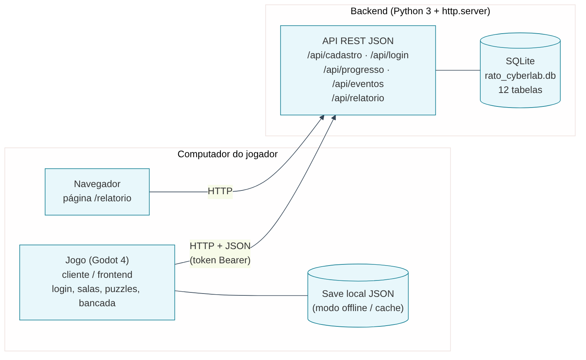
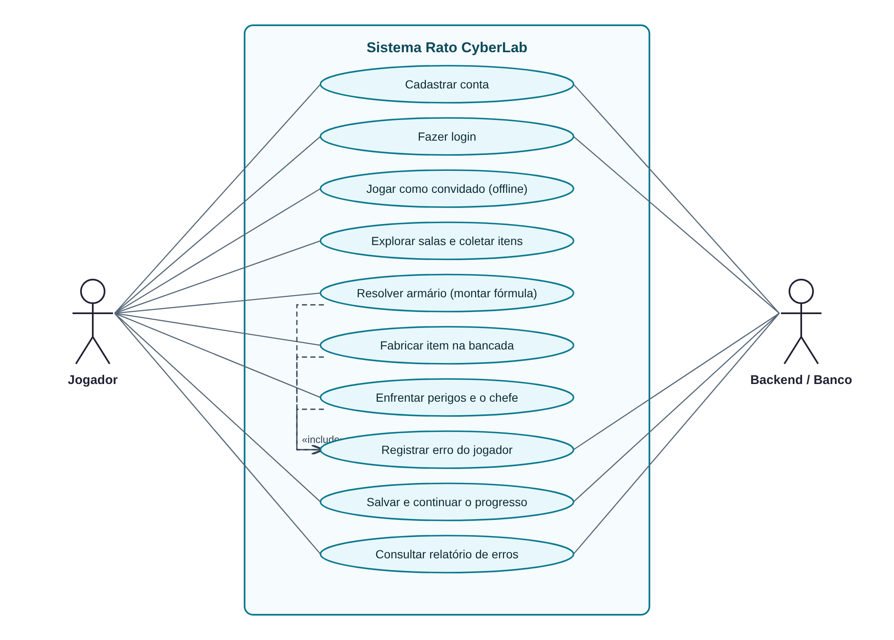
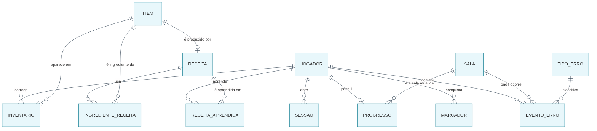
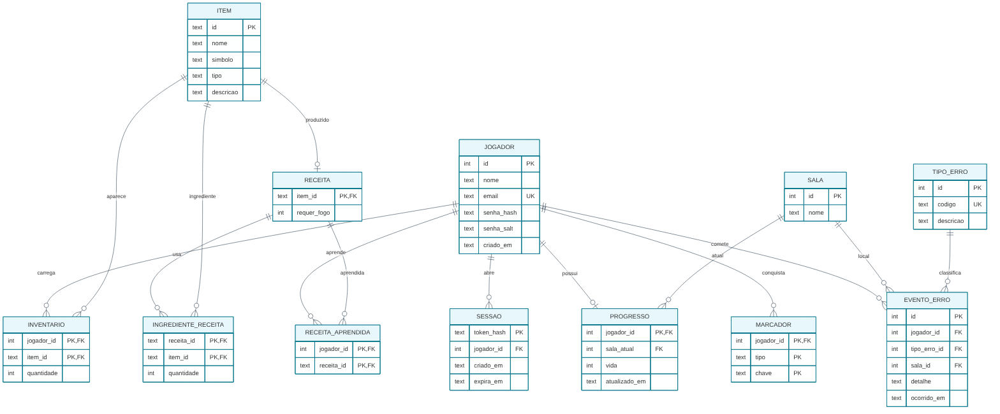
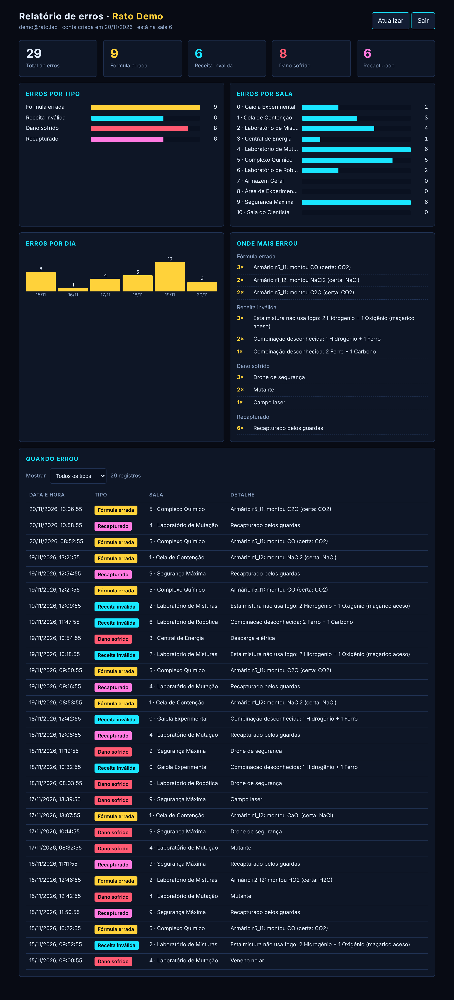

# Rato CyberLab (R-31) — Documentação do banco de dados

Projeto e Engenharia de Software · UNA Barreiro · Entrega parcial de 20/11/2026

SGBD: **SQLite 3** (arquivo `backend/rato_cyberlab.db`, criado automaticamente pelo backend).
Scripts: `backend/schema.sql` (tabelas) e `backend/seed.sql` (salas, itens e receitas, gerado a partir do jogo).

## 1. Arquitetura (frontend + backend + banco)



- **Frontend:** o jogo em Godot 4. Tem tela de cadastro/login, envia cada erro do jogador e grava o progresso no servidor.
- **Backend:** `backend/server.py`, API REST em Python 3 (só biblioteca padrão). Valida os dados, protege as senhas e fala com o SQLite.
- **Banco:** SQLite, 12 tabelas em 3ª forma normal.
- **Relatório:** página `/relatorio` (HTML) que mostra ao jogador **quando e onde ele errou**.
- **Sem servidor:** o jogo continua funcionando (modo convidado ou queda de conexão). Os erros e o progresso ficam guardados localmente e são enviados quando o servidor volta.

## 2. Diagrama de caso de uso



| Caso de uso | Ator(es) | Descrição |
|---|---|---|
| Cadastrar conta | Jogador, Backend | Informa nome, e-mail e senha. O e-mail é único; a senha é guardada com hash PBKDF2 + sal. |
| Fazer login | Jogador, Backend | Valida e-mail e senha e devolve um token de sessão (30 dias). Bloqueia após 10 tentativas erradas em 5 min. |
| Jogar como convidado | Jogador | Joga sem conta, usando só o save local. Não gera relatório. |
| Explorar salas e coletar itens | Jogador | Percorre as 11 salas e coleta elementos químicos. |
| Resolver armário | Jogador | Monta a fórmula química correta no computador do armário. Erro gera evento `FORMULA_ERRADA`. |
| Fabricar item na bancada | Jogador | Mistura elementos para criar itens. Mistura inválida gera `RECEITA_INVALIDA`. |
| Enfrentar perigos e o chefe | Jogador | Dano gera `DANO`; vida zerada gera `MORTE` (recapturado). |
| Registrar erro do jogador | Backend | Incluído pelos três casos acima. Grava tipo, sala, detalhe e data/hora em `evento_erro`. |
| Salvar e continuar o progresso | Jogador, Backend | Sala, vida, inventário, receitas e marcos ficam no banco e voltam no próximo login. |
| Consultar relatório de erros | Jogador, Backend | Totais por tipo, por sala e por dia, erros mais comuns e lista com data e hora. |

## 3. DER (modelo conceitual)



Um **jogador** abre várias **sessões**, tem no máximo um **progresso** e comete vários **eventos de erro**. Cada evento é de um **tipo de erro** e acontece numa **sala**. O jogador carrega itens (**inventário**), aprende **receitas** e conquista **marcadores** de campanha. Cada receita produz um item e usa vários itens como **ingredientes**.

## 4. Modelo relacional (tabelas)



Notação: **PK** chave primária · **FK** chave estrangeira · **UK** única.

```
jogador(id PK, nome, email UK, senha_hash, senha_salt, criado_em)
sessao(token_hash PK, jogador_id FK→jogador, criado_em, expira_em)
sala(id PK, nome)
item(id PK, nome, simbolo, tipo, descricao)
receita(item_id PK/FK→item, requer_fogo)
ingrediente_receita(receita_id PK/FK→receita, item_id PK/FK→item, quantidade)
progresso(jogador_id PK/FK→jogador, sala_atual FK→sala, vida, atualizado_em)
inventario(jogador_id PK/FK→jogador, item_id PK/FK→item, quantidade)
receita_aprendida(jogador_id PK/FK→jogador, receita_id PK/FK→receita)
marcador(jogador_id PK/FK→jogador, tipo PK, chave PK)
tipo_erro(id PK, codigo UK, descricao)
evento_erro(id PK, jogador_id FK→jogador, tipo_erro_id FK→tipo_erro, sala_id FK→sala, detalhe, ocorrido_em)
```

## 5. Dicionário de dados

Datas são texto ISO 8601 em UTC (`2026-11-20T16:53:34Z`). SQLite não tem tipo data nativo.

### jogador — conta de quem joga
| Coluna | Tipo | Restrições | Descrição |
|---|---|---|---|
| id | INTEGER | PK, autoincremento | Identificador do jogador |
| nome | TEXT | NOT NULL, 2 a 60 caracteres | Nome de jogador exibido no jogo e no relatório |
| email | TEXT | NOT NULL, UNIQUE, formato `a@b.c` | Login. Guardado em minúsculas |
| senha_hash | TEXT | NOT NULL | PBKDF2-HMAC-SHA256, 200 mil iterações (64 caracteres hex) |
| senha_salt | TEXT | NOT NULL | Sal aleatório de 16 bytes (32 caracteres hex) |
| criado_em | TEXT | NOT NULL, padrão agora | Data do cadastro |

### sessao — login ativo
| Coluna | Tipo | Restrições | Descrição |
|---|---|---|---|
| token_hash | TEXT | PK | SHA-256 do token entregue ao jogo (o token em si nunca é guardado) |
| jogador_id | INTEGER | NOT NULL, FK jogador, ON DELETE CASCADE | Dono da sessão |
| criado_em | TEXT | NOT NULL | Início |
| expira_em | TEXT | NOT NULL | Validade (30 dias) |

### sala — catálogo de salas
| Coluna | Tipo | Restrições | Descrição |
|---|---|---|---|
| id | INTEGER | PK | 0 = tutorial (gaiola) até 10 = sala do cientista |
| nome | TEXT | NOT NULL | Nome da sala |

### item — catálogo de itens
| Coluna | Tipo | Restrições | Descrição |
|---|---|---|---|
| id | TEXT | PK | Identificador usado no jogo (`h`, `fe`, `agua`…) |
| nome | TEXT | NOT NULL | Nome exibido |
| simbolo | TEXT | NOT NULL | Símbolo químico ou fórmula |
| tipo | TEXT | NOT NULL, CHECK (`elemento`, `ficticio`, `fabricado`) | Categoria |
| descricao | TEXT | NOT NULL | Texto educativo |

### receita — itens que podem ser fabricados
| Coluna | Tipo | Restrições | Descrição |
|---|---|---|---|
| item_id | TEXT | PK, FK item | Item produzido |
| requer_fogo | INTEGER | NOT NULL, CHECK 0 ou 1 | 1 se precisa do maçarico aceso |

### ingrediente_receita — o que cada receita consome
| Coluna | Tipo | Restrições | Descrição |
|---|---|---|---|
| receita_id | TEXT | PK, FK receita | Receita |
| item_id | TEXT | PK, FK item | Ingrediente |
| quantidade | INTEGER | NOT NULL, > 0 | Unidades necessárias |

### progresso — onde o jogador parou
| Coluna | Tipo | Restrições | Descrição |
|---|---|---|---|
| jogador_id | INTEGER | PK, FK jogador, CASCADE | Dono (um progresso por jogador) |
| sala_atual | INTEGER | NOT NULL, FK sala | Sala onde está |
| vida | INTEGER | NOT NULL, CHECK 0 a 3 | Vida restante |
| atualizado_em | TEXT | NOT NULL | Último save |

### inventario — itens carregados
| Coluna | Tipo | Restrições | Descrição |
|---|---|---|---|
| jogador_id | INTEGER | PK, FK jogador, CASCADE | Dono |
| item_id | TEXT | PK, FK item | Item |
| quantidade | INTEGER | NOT NULL, > 0 | Quantidade |

### receita_aprendida — receitas já descobertas
| Coluna | Tipo | Restrições | Descrição |
|---|---|---|---|
| jogador_id | INTEGER | PK, FK jogador, CASCADE | Jogador |
| receita_id | TEXT | PK, FK receita | Receita aprendida |

### marcador — marcos da campanha
| Coluna | Tipo | Restrições | Descrição |
|---|---|---|---|
| jogador_id | INTEGER | PK, FK jogador, CASCADE | Jogador |
| tipo | TEXT | PK, CHECK (`flag`, `coleta`) | `flag` = evento de história concluído; `coleta` = item/armário já recolhido ou sala já vista |
| chave | TEXT | PK | Nome do marco (ex.: `r3_power`, `seen_4`) |

### tipo_erro — classificação dos erros
| Coluna | Tipo | Restrições | Descrição |
|---|---|---|---|
| id | INTEGER | PK | Identificador |
| codigo | TEXT | NOT NULL, UNIQUE | `FORMULA_ERRADA`, `RECEITA_INVALIDA`, `DANO`, `MORTE` |
| descricao | TEXT | NOT NULL | Texto exibido no relatório |

### evento_erro — cada erro do jogador (base do relatório)
| Coluna | Tipo | Restrições | Descrição |
|---|---|---|---|
| id | INTEGER | PK, autoincremento | Identificador |
| jogador_id | INTEGER | NOT NULL, FK jogador, CASCADE | Quem errou |
| tipo_erro_id | INTEGER | NOT NULL, FK tipo_erro | Tipo do erro |
| sala_id | INTEGER | NOT NULL, FK sala | Sala onde ocorreu |
| detalhe | TEXT | NOT NULL, até 200 caracteres | Ex.: `Armário r1_l2: montou NaCl2 (certa: NaCl)` |
| ocorrido_em | TEXT | NOT NULL | Data e hora do erro. Índice em (`jogador_id`, `ocorrido_em`) |

## 6. Normalização

**1ª forma normal (1FN).** Todos os campos são atômicos. O save original do jogo era um JSON com listas e dicionários dentro de um único registro (`inv`, `flags`, `learned`, `taken`), o que repetia grupos de valores. Foi dividido em linhas: `inventario` (uma linha por item), `receita_aprendida` (uma por receita) e `marcador` (uma por marco). Cada tabela tem chave primária.

**2ª forma normal (2FN).** Nas tabelas com chave composta, todo atributo depende da chave inteira:
- `inventario (jogador_id, item_id) → quantidade`
- `ingrediente_receita (receita_id, item_id) → quantidade`
- `marcador`, `receita_aprendida`: a chave é composta e não há atributos fora dela.

Nome, símbolo e descrição do item dependem só de `item_id`, então ficam em `item` e não em `inventario`. O nome da sala depende só de `sala_id`, então fica em `sala`.

**3ª forma normal (3FN).** Não há dependência transitiva entre atributos não-chave:
- `evento_erro` guarda só `tipo_erro_id` e `sala_id`. A descrição do tipo está em `tipo_erro` e o nome da sala em `sala`.
- `progresso` guarda `sala_atual` e não o nome da sala.
- `sessao` guarda `jogador_id` e não os dados do jogador.
- `receita` e `ingrediente_receita` separam o que a receita é do que ela consome.

**Decisões de projeto**
- `marcador.chave` é texto livre porque os marcos de história são definidos pelo jogo. Isso evita uma tabela de catálogo para dezenas de chaves que mudam a cada sala nova.
- `evento_erro.detalhe` é texto descritivo para o jogador ler no relatório. Não é usado como chave.
- O catálogo (`sala`, `item`, `receita`) é gerado do próprio jogo por `gerar_seed.py`. O banco não fica diferente do jogo.

## 7. Como o relatório é montado (consultas SQL)

Erros por tipo (inclui tipos com zero erros):
```sql
SELECT t.codigo, t.descricao, COUNT(e.id) AS total
FROM tipo_erro t
LEFT JOIN evento_erro e ON e.tipo_erro_id = t.id AND e.jogador_id = :jogador
GROUP BY t.id ORDER BY t.id;
```
Erros por sala:
```sql
SELECT s.id, s.nome, COUNT(e.id) AS total
FROM sala s
LEFT JOIN evento_erro e ON e.sala_id = s.id AND e.jogador_id = :jogador
GROUP BY s.id ORDER BY s.id;
```
Quando errou (linha do tempo):
```sql
SELECT e.ocorrido_em, t.descricao, s.nome AS sala, e.detalhe
FROM evento_erro e
JOIN tipo_erro t ON t.id = e.tipo_erro_id
JOIN sala s ON s.id = e.sala_id
WHERE e.jogador_id = :jogador
ORDER BY e.ocorrido_em DESC;
```



## 8. API do backend

| Método e rota | Autenticação | Função |
|---|---|---|
| `POST /api/cadastro` | não | Cria a conta e já faz login |
| `POST /api/login` | não | Devolve o token de sessão |
| `POST /api/logout` | sim | Encerra a sessão |
| `GET /api/progresso` | sim | Carrega o save do banco |
| `PUT /api/progresso` | sim | Grava o save no banco |
| `POST /api/eventos` | sim | Registra um ou mais erros |
| `GET /api/relatorio` | sim | Resumo e lista de erros do jogador |
| `GET /relatorio` | não (a página pede login) | Página HTML do relatório |

Segurança: senhas com PBKDF2 e sal individual; token de sessão guardado apenas como hash; consultas parametrizadas (sem concatenar texto em SQL); validação de todos os campos; limite de tentativas de login; cada jogador só enxerga os próprios dados.

## 9. Testes

- `backend/tests/test_api.py`: 16 testes da API (cadastro, login, validações, bloqueio de força bruta, progresso, erros, relatório, isolamento entre jogadores, SQL injection).
- `proj/tests/api_e2e.gd`: teste ponta a ponta com o jogo real, o backend e o banco (cadastro, erros reais de fórmula/receita/dano/morte, save no banco, novo login restaurando o save, servidor fora do ar).
- `proj/tests/playtest.gd`: playtest original das 11 salas (102 verificações), sem regressão.
